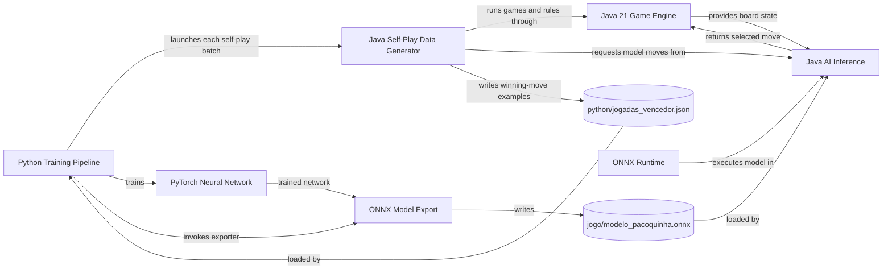
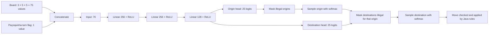
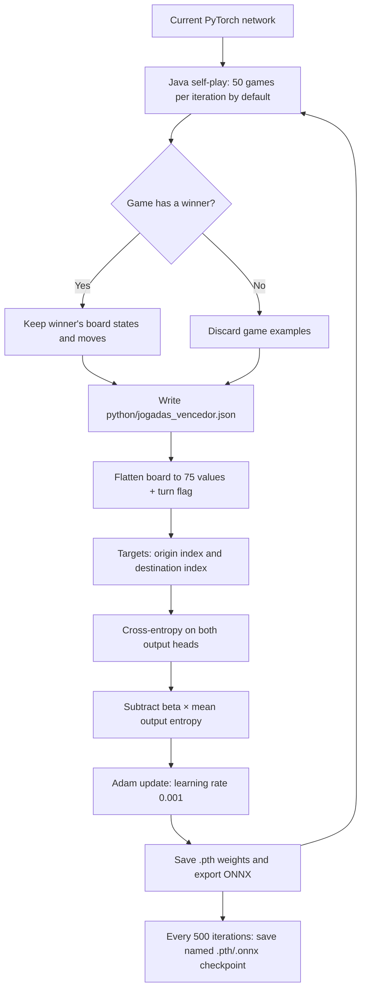

# Jogo da Paçoquinha

A Java 21 implementation of *Jogo da Paçoquinha*, a two-player board game, with a Swing graphical interface and an optional neural-network opponent. The game runs in Java; the AI is trained separately with Python and PyTorch, then exported to ONNX for Java inference.

## Screenshots

There are no screenshots in the repository yet. Useful screenshots to add later would show:

- The game board during a match.
- A game against the neural-network opponent.

## Requirements

- JDK 21
- Apache Maven 3.8 or later
- A graphical desktop environment to open the Swing interface

Check which JDK Maven is using with:

```bash
java -version
javac -version
mvn -version
```

`mvn -version` must report Java 21 as well. If compilation reports `release version 21 not supported`, configure `JAVA_HOME` and `PATH` to point to JDK 21, then open a new terminal.

## Run the game

From the repository root, start the graphical game with:

```bash
mvn compile exec:java -pl jogo
```

To build and run the executable JAR:

```bash
mvn package
java -jar jogo/target/jogo-1.0-SNAPSHOT.jar
```

The JAR includes ONNX Runtime and the ONNX model. It requires Java 21 and can be launched from any directory.

### How to play

The board is a 5×5 grid. Each player has five pieces, and a shared piece called the *paçoquinha* starts in the center. On a turn, the active player moves either one of their own pieces or the paçoquinha, as indicated above the board. Select a piece, then select its destination. Click the selected piece again to cancel. **New Game** starts a two-player game; **Play against AI** starts a game where Player 1 is human and Player 2 is controlled by the model.

A piece moves horizontally, vertically, or diagonally, and must travel as far as possible in the chosen direction: it stops at the board edge or immediately before another piece. Player 1 wins by moving the paçoquinha to the top row; Player 2 wins by moving it to the bottom row. The player who moves one of their own pieces also wins if that move leaves the paçoquinha with no available move.

## Project layout

```text
pom.xml                      Parent Maven project; training module is opt-in
jogo/                        Game rules, Swing UI, ONNX inference, executable JAR
  src/main/java/
    jogo/                    Game state, turns, win checking, AI integration
    jogo/tabuleiro/          Board and pieces
    interfacegrafica/        Swing interface
  src/test/java/             JUnit 5 tests
  modelo_pacoquinha.onnx     Model loaded by the game and updated by training
treino/                      Java self-play data generator (optional Maven module)
python/                      PyTorch model, training loop, weights, and generated data
```

## System Architecture

The Python training loop coordinates the training cycle: it launches the Java self-play generator, reads the generated JSON examples, updates the PyTorch network, and exports the ONNX model. Both self-play and the interactive game use the Java AI inference code, which runs the ONNX model through ONNX Runtime. The game engine applies the selected moves and checks the rules.



During normal play, `jogo/src/main/java/jogo/IA.java` loads `jogo/modelo_pacoquinha.onnx` when that file is available from the current working directory; otherwise, it loads the model embedded in the JAR. The training pipeline exports to the repository's `jogo/modelo_pacoquinha.onnx`, so the next game or self-play process can use the updated model.

## AI overview

The AI is a feed-forward multilayer perceptron implemented in PyTorch. Its input has 76 floating-point values: the flattened 3×5×5 board tensor (paçoquinha, Player 1 pieces, Player 2 pieces, in that order) followed by a flag indicating whether the paçoquinha must move. Two output heads produce 25 logits each: one scores the origin square and the other scores the destination square.

| Component | Dimensions |
| --- | ---: |
| Board representation | 3 × 5 × 5 = 75 values |
| Turn indicator | 1 value |
| Total input | 76 values |
| Origin output head | 25 logits |
| Destination output head | 25 logits |

The two output heads represent related decisions in a move: the origin head selects a piece or the paçoquinha, and the destination head selects where that piece moves. Java samples the origin first, then masks the destination logits to legal destinations for that selected origin before sampling the destination. This factorizes move prediction into origin selection followed by a destination distribution conditioned on the selected origin. Given the board's small 5×5 size, the implementation uses fully connected layers for its representation. The project does not claim this architecture is superior to alternatives.



At inference time, Java prepares the same 76-value representation and runs the ONNX model using ONNX Runtime. Before sampling, it masks origins that do not contain a movable piece and masks destinations that are not legal for the chosen origin. It samples from each masked softmax distribution, rather than simply taking the highest-scoring square. This keeps generated moves legal while allowing the model's scores to guide its choices.

## Training approach

Training combines Java self-play with supervised imitation learning in Python. In each generated game, the same network controls both sides. Player 1's board is vertically mirrored so the model can use the same coordinate perspective for either side. During training, epsilon exploration sometimes replaces the model's choice with a random legal origin and then a random legal destination for that origin. Only the moves made by the winner are saved; games without a winner (including games reaching the 200-move cap) contribute no examples.

This is winner-move imitation: the model learns to predict the origin and destination in moves that occurred in winning games. It does not use a value head, Q-learning, or a direct reward-based policy update.

### Training Limitations

Only moves from the winning side of a game are retained as training examples. Games without a winner are discarded. As a result, the model imitates recorded moves rather than receiving a direct reward-based update, and the quality and variety of its examples depend on the self-play games generated by the current model and exploration settings. Using only winning-side moves also leaves out moves from losing games, so the training data provides a selective view of the positions and decisions encountered during self-play.



For each iteration, Python trains on the full winning-move dataset produced by that iteration. The imitation loss is the sum of cross-entropy losses for the origin and destination heads. The objective also subtracts a small entropy term (`beta`, default `0.01`) to discourage the output distributions from becoming too confident too early. The optimizer is Adam with a learning rate of `0.001`.

## Train the AI

Install the Python dependencies:

```bash
python -m pip install -r python/requirements.txt
```

Run the complete Java self-play and Python training loop:

```bash
python python/ciclo_treino.py
```

Defaults are 50,000 iterations, 50 self-play games per iteration, epsilon `0.1`, beta `0.01`, and a checkpoint every 500 iterations. The default run is intentionally long. For a shorter run, for example:

```bash
python python/ciclo_treino.py --iteracoes 100 --partidas 10 --salvar-a-cada 25
```

Available options are `--iteracoes`, `--partidas`, `--epsilon`, `--beta`, and `--salvar-a-cada`. The loop compiles and installs the Java modules it needs, generates `python/jogadas_vencedor.json`, updates `python/modelo_pacoquinha.pth`, and exports the inference model to `jogo/modelo_pacoquinha.onnx`. Named `.pth` and `.onnx` checkpoints are saved in `python/modelos/` at the configured interval.

To build only the game, use the normal Maven commands above. The Java training module is excluded from the default Maven build; the Python cycle includes it automatically. To compile the game and training modules together, run:

```bash
mvn -P treino compile
```

## Tests

Run the Java JUnit 5 tests with:

```bash
mvn test
```

The tests are in `jogo/src/test/java` and do not require a graphical display.

## Optional native application image

To create an application image with `jpackage` (requires JDK 21), first build the JAR, then run:

```bash
mkdir -p dist/entrada
cp jogo/target/jogo-1.0-SNAPSHOT.jar dist/entrada/
jpackage --type app-image --name JogoDaPacoquinha --input dist/entrada \
  --main-jar jogo-1.0-SNAPSHOT.jar \
  --main-class interfacegrafica.InterfaceGrafica --dest dist
```

The launcher is at `dist/JogoDaPacoquinha/bin/JogoDaPacoquinha`. You can use `--type deb` on Linux to create a Debian installer; create a Windows `.exe` package by running the equivalent command on Windows.

## Development and Contribution

- **Java modules:** `jogo/src/main/java/` contains the game and inference code; `treino/src/main/java/treino/TreinoIA.java` generates self-play data. The training module is opt-in in `pom.xml`.
- **Python pipeline:** `python/ciclo_treino.py` coordinates self-play, training, and export; `python/treino.py` reads examples and performs optimization; `python/rede.py` defines the neural-network architecture.
- **Game rules:** Start with `jogo/src/main/java/jogo/JogoDaPacoquinha.java` for turn and move handling, `jogo/src/main/java/jogo/tabuleiro/Tabuleiro.java` for board movement rules, `jogo/src/main/java/jogo/ChecadorVitoria.java` for win conditions, and `jogo/src/main/java/jogo/Turno.java` for turn order.
- **Tests:** Run `mvn test`. The Java tests are in `jogo/src/test/java/`.
- **Training:** Install the dependencies and run the training command in [Train the AI](#train-the-ai). The loop generates `python/jogadas_vencedor.json` and saves the current PyTorch weights to `python/modelo_pacoquinha.pth`.
- **Updating the game model:** Run the training pipeline to export the updated model to `jogo/modelo_pacoquinha.onnx`. Run `mvn package` again to include that model in a newly built JAR. During development from the repository root, Java prefers the ONNX file on disk; a packaged JAR embeds the model as a fallback when the disk path is unavailable.

## Credits and Contributions

This project was developed by a pair. The work involved collaboration on the game engine, neural-network architecture, and training pipeline.
